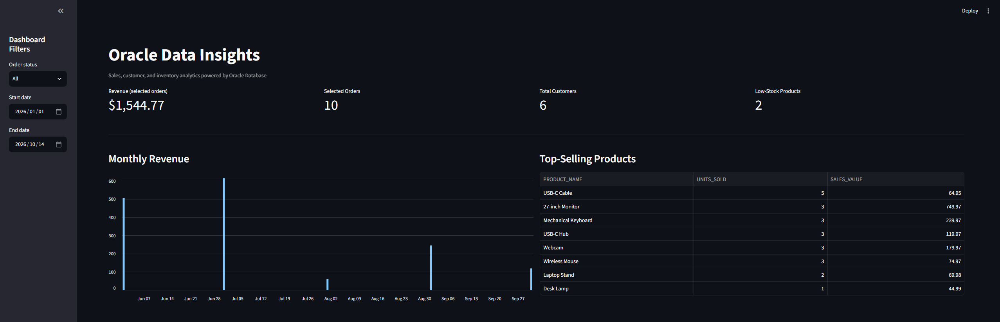
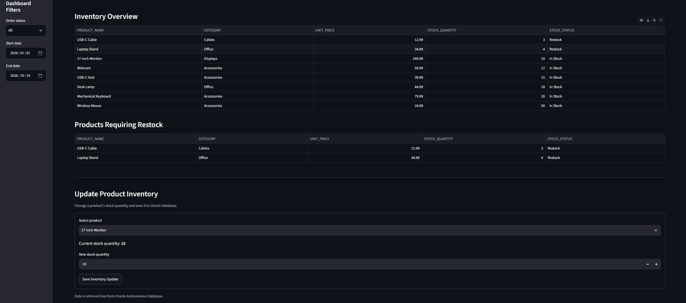

# Oracle Data Insights


An interactive sales and inventory analytics application built with Python, Streamlit, and Oracle Autonomous Database.


## Overview


Oracle Data Insights demonstrates how a cloud-connected Python application can query, analyze, and update relational data stored in Oracle Database. The dashboard provides sales performance metrics, order filtering, product analytics, and inventory management.

## Dashboard Preview

### Revenue Analytics


### Inventory Management


## Features


- **Interactive dashboard:** KPI cards for revenue, order counts, customer counts, and low-stock products.

- **Sales analytics:** Monthly revenue chart and top-selling product table.

- **Filtering:** Filter order analytics by order status and date range.

- **Inventory management:** Update product stock quantities directly in Oracle Database.

- **Relational data model:** Four related tables with primary keys, foreign keys, and validation constraints.

- **Automated tests:** Pytest coverage for date validation, stock validation, and inventory update behavior.

- **Application logging:** Local log file with error details for troubleshooting.

## Database Design

The project uses Oracle Autonomous AI Database with a relational schema consisting of four tables:

- **CUSTOMERS** — Stores customer information.
- **PRODUCTS** — Stores product details, pricing, and inventory quantities.
- **ORDERS** — Records customer orders, dates, and order statuses.
- **ORDER_ITEMS** — Connects orders to products and records quantities and unit prices.

### Relationships

- Each customer can have multiple orders.
- Each order can contain multiple order items.
- Each product can appear in multiple order items.
- Primary keys and foreign keys maintain referential integrity across related tables.

### Data Analysis

SQL queries join orders and order items to calculate revenue, aggregate sales by month, and identify top-selling products. Inventory queries identify products with low stock, while parameterized queries support order-status and date-range filtering.

The database schema uses constraints to help maintain data integrity, and Python handles database connectivity and inventory updates.


## Technology Stack

\- Oracle Autonomous Database

\- Oracle SQL

\- Python

\- `oracledb`

\- Pandas

\- Streamlit

\- Pytest

\- Python Dotenv


## Database Design


The application uses four related tables:


| Table | Purpose |

|---|---|

| `CUSTOMERS` | Customer details and registration dates |

| `PRODUCTS` | Product prices, categories, and stock quantities |

| `ORDERS` | Customer orders, dates, and statuses |

| `ORDER\_ITEMS` | Products, quantities, and prices associated with orders |


The sample dataset contains 6 customers, 8 products, 10 orders, and 16 order items.


## Project Structure


```text

oracle-data-insights/

├── app/

│   ├── dashboard.py

│   ├── inventory.py

│   ├── logging\_config.py

│   └── validation.py

├── sql/

│   ├── 02\_create\_tables.sql

│   └── 03\_insert\_sample\_data.sql

├── tests/

│   ├── test\_dashboard.py

│   └── test\_inventory.py

├── wallet/                 # Local only; not committed

├── .env                    # Local only; not committed

├── .gitignore

├── create\_schema.py

├── load\_sample\_data.py

├── test\_connection.py

└── README.md

```


## Setup


### Prerequisites


\- Python installed

\- An Oracle Autonomous Database

\- An Oracle database wallet configured for your database

\- Git, if cloning the project from GitHub


### 1. Clone the repository


```bash

git clone https://github.com/Dieg0T0r0/oracle-data-insights.git

cd oracle-data-insights

```


### 2. Create and activate a virtual environment


Windows:


```bat

py -m venv .venv

.venv\\Scripts\\activate

```


### 3. Install dependencies


```bash

python -m pip install streamlit oracledb pandas python-dotenv pytest

```


### 4. Configure Oracle credentials


Place your wallet files in the local `wallet/` directory and create a `.env` file in the project root:


```dotenv

ORACLE\_USER=ADMIN

ORACLE\_PASSWORD=your\_database\_password

ORACLE\_DSN=datainsights\_medium

ORACLE\_WALLET\_LOCATION=C:\\path\\to\\oracle-data-insights\\wallet

ORACLE\_WALLET\_PASSWORD=your\_wallet\_password

```


Replace the example values with your own configuration. Never commit your `.env` file or wallet credentials.


### 5. Verify the connection


```bash

python test\_connection.py

```


### 6. Create and load the database


Run the schema creation script first:


```bash

python create\_schema.py

```


Then load the sample data:


```bash

python load\_sample\_data.py

```


\*\*Important:\*\* The sample-data script is intended for initial setup. Do not rerun it against an already populated database without first reviewing the script and existing data.


### 7. Launch the dashboard


```bash

python -m streamlit run app/dashboard.py

```


Open the local URL displayed by Streamlit in your browser.


## Testing


Run the automated test suite:


```bash

python -m pytest -v

```


The tests cover date-range validation, stock-quantity validation, and inventory update behavior using mocked database connections.


## Security


\- Database credentials are stored in a local `.env` file.

\- Oracle wallet files are kept outside version control.

\- SQL updates use bind variables.

\- Inventory quantities are validated before database updates.

\- Automated inventory tests use mock database connections rather than modifying live data.


## Future Improvements


\- Add sales comparisons and additional business KPIs.

\- Introduce automated integration tests against a dedicated test database.

\- Add role-based access controls for inventory updates.

\- Add deployment instructions for a hosted dashboard.


## Author


Developed as a personal portfolio project to demonstrate Oracle SQL, Python application development, cloud database connectivity, data analytics, and testing.

